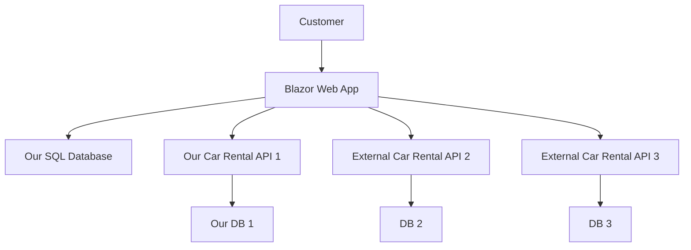

# MiNICarRental 🚗

A college project developed for the *Web Application Development with .NET* course at Warsaw University of Technology.  
It consists of:
- A **Car Rental API**
- A **Blazor-based Web Application** communicating with this API and external services.

The system supports two types of users:
- **Customer** – can rent cars from all integrated APIs and view rentals made through our app.
- **Employee** – manages all rentals created via our API.

## Features ✨
- User authentication via **OAuth**
- Browse and rent cars from multiple APIs
- Manage personal rentals
- Employee panel for managing all rentals from our API
- Email notifications via **SendGrid**
- Caching with **Redis**
- Blob storage for images and files
- Separate SQL databases for API and Web App

## Tech Stack 🛠
- **Frontend:** Blazor Server
- **Backend:** .NET API + Entity Framework
- **Database:** Microsoft SQL Server (local), Azure SQL Database (production)
- **Caching:** Redis
- **Authentication:** OAuth
- **Email:** SendGrid SMTP
- **Hosting:** Azure (App Service, Blob Storage, Key Vault)
- **Version Control:** Azure DevOps with Git

## Project Architecture 🏗

## Running the project

The application ran on Azure resources created for the course (App Service, Azure SQL, Key Vault, Blob Storage, Redis), together with car rental APIs of other student teams. These were shut down after the semester, and both apps load their configuration from that Key Vault at startup, so the project no longer runs as it is. Running it again would need your own Azure Key Vault (or user secrets) with the database, Redis, Blob Storage, SendGrid and OAuth settings. The solution still builds with `dotnet build MiNICarRental.sln`.

## My Contribution 💼
- Designed and implemented following pages: **car browser**, **rental history for both client and employee**, **error** and **layouts**
- Integrated **Redis** caching layer
- Implemented synchronization of car data from external APIs
- Implemented **Hangfire** for background jobs
- Worked on multiple API modules alongside teammates, as the API was developed collaboratively so each member could learn the full stack.

## Contributors 👥
| Name                  | GitHub |
|-----------------------|------------------------------|
| **Kuba Drażan**       | [GitHub](https://github.com/kubadrazan) |
| **Piotr Iśtok**       | [GitHub](https://github.com/p10tr13) |
| **Igor Kober**        | [GitHub](https://github.com/Kobiuy) |

## Instructor 🎓
**Marcin Sulecki** - [GitHub](https://github.com/sulmar)

## License 📜
MIT License
